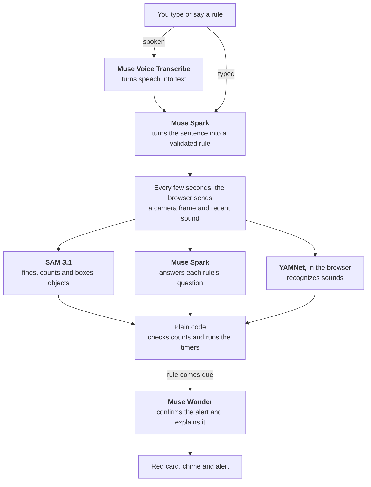

# Vivre

**Entry for the [Meta Global AI Developer Hackathon](https://dev.meta.ai/events/global-hackathon): Indie Developer track, Build for Your World.**

Tell Vivre what to watch for in a plain sentence, like "Tell me if the stove is on with a pot and nobody has been in the kitchen for 10 seconds." It watches through your camera and microphone and alerts you when that happens.

**Try it:** https://web-production-749fb.up.railway.app (use Chrome or Safari, allow the camera, then pick or type a rule)

Vivre is a prototype, not a safety device. It checks every few seconds and can miss things or get them wrong, so use it alongside smoke alarms and medical-alert gear, not instead of them.

Vivre runs on Meta's models, plus one Google model for recognizing sounds. It was built during the hackathon, with help from Claude.

## What it does

- You type or say a rule, and Vivre shows the rule it understood on a paper "Vivre Card".
- It checks the camera for what the rule names. It also listens for speech, like a call for help, or for sounds like clapping or a baby crying.
- Plain code tracks how long something has lasted, and the card's corner folds further as the timer runs.
- When a rule fires, the card turns red and you get a chime, plus a spoken alert on a computer and a one-sentence explanation.
- Each alert is logged with its time and a short replay clip. Clips stay in your browser.
- A private link sends cards and alerts to a second device, without the video or sound.

## How it works

For camera rules, Muse Wonder can reject the alert. Rules about speech or sounds can't wait, so the alert fires first and Muse Wonder explains it afterward.

### Meta tools used

| Model | What it does in Vivre |
|---|---|
| Muse Voice Transcribe | Turns a spoken rule into text |
| Muse Spark 1.2 | Turns a sentence into a structured rule, which the server validates, then answers each rule's question from the frame and from recent speech. The example buttons use saved rules, so they skip the first step |
| SAM 3.1 | Finds and counts objects for camera rules and draws boxes on the video. "Nobody at the desk" becomes "0 person", and if SAM sees a person, plain code overrules Spark |
| Muse Wonder 1.0 | Confirms or rejects a camera alert before it fires, and explains it. For speech and sound rules, it explains after the alert and says so if it disagrees |

All of these run through the Meta Model API.

One model isn't Meta's: YAMNet, by Google, recognizes everyday sounds in your browser through MediaPipe.

Still frames skip the model calls, and Muse Wonder only runs when a rule comes due. The screen shows each model's job, timing and estimated cost.

## Safety and privacy

What Vivre can access:
- Only the camera and microphone you allow, in that browser tab, while you're watching.
- The microphone only turns on for a spoken rule or a rule about sounds.
- It can't reach your files or other apps. The models have no tools, and the server checks what they return before using it.

Where your data goes:
- Camera frames go to Meta's API for analysis. For speech rules, a few seconds of sound do too.
- The sound recognizer runs in your browser, but for sound rules a short clip still goes to Meta's API so Muse Wonder can explain the alert.
- The second-device link shares card states and alerts, never video or sound. Anyone with the link can see those while the session runs.

What Vivre keeps:
- The server holds the last few frames and the latest sound clip in memory during a session. It doesn't write frames or sound to disk.
- Replay clips stay in your browser until you close the tab or start a new session, unless you download one.
- There are no accounts and no database.

Only film people who have agreed.

## Limits

- Each check takes a few seconds, so Vivre can miss something that's over quickly.
- I've only tested it informally in a few simple scenes, so expect false alarms and misses.
- For sound recognition, I've tried real clapping and a video of a baby crying. Other sounds are untested.
- A rule won't fire if SAM can't find something a camera rule requires.
- Motion rules compare two frames taken a few seconds apart.
- Alerts need the page open. Vivre doesn't send phone notifications and isn't connected to any camera system.
- The hosted link may not work at times. Meta's API has sometimes answered the hosted server with "model not found" for long stretches while the same calls worked from a laptop, and I don't know why. The example sound rules still work when that happens, and running Vivre locally avoids it.
- Live use is capped per session, per visitor and overall, and a session stops after 4 minutes.

## Run it yourself

1. `python3 -m venv .venv && source .venv/bin/activate`
2. `pip install -r requirements.txt`
3. Copy `.env.example` to `.env` and add your Meta Model API key. Don't commit `.env`.
4. Run `uvicorn server:app --reload`, then open http://localhost:8000 in Chrome or Safari.

The tests use fake models, so they cost nothing:

- `python -m unittest discover tests`
- `node --test tests/frontend.test.mjs`

To host it, set `MODEL_API_KEY` and `TRUST_PROXY=1` in your host's settings. `.env.example` lists the spending caps.

## Third-party files and credits

- `static/vendor/` holds Google's MediaPipe audio library (`@mediapipe/tasks-audio`, Apache-2.0) and the YAMNet model. See `static/vendor/README.txt`.
- The design review method came from [unslop](https://github.com/heydamir/unslop) by Damir Sokolovsky (CC BY 4.0).

## Contact

Questions? Email Ky at kyhoangg@berkeley.edu.
