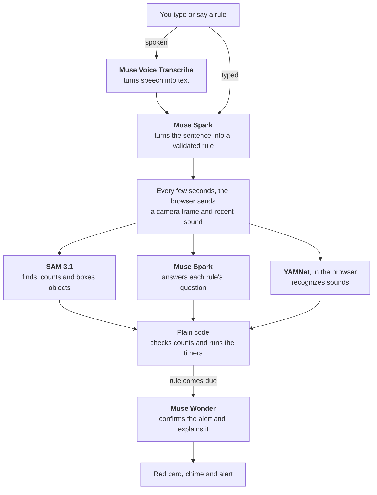

# Vivre

**Built for the [Meta Global AI Developer Hackathon](https://dev.meta.ai/events/global-hackathon) (Indie Developer track, Build for Your World).**

Tell Vivre what to watch for in a plain sentence. It watches through your camera and microphone and alerts you when it happens.

**Try it:** https://web-production-749fb.up.railway.app

Open it in Chrome or Safari, allow the camera, then pick or type a rule. A live session runs for up to 4 minutes. If the hosted link can't reach Meta's API, try again in a few minutes or run Vivre yourself using the steps below.

## What is Vivre?

Vivre turns a browser and a camera into something that can watch for whatever you describe. There's no menu of detections to choose from and nothing to train. You write a sentence like one of these:

- "Tell me if the stove is on with a pot and nobody has been in the kitchen for 10 seconds"
- "Tell me if someone calls for help"
- "Tell me if a baby is crying"

Vivre turns that sentence into a rule you can read on a paper "Vivre Card", then keeps checking for it. Several Meta models work together on each rule, and plain code keeps the time.

Vivre was built during the hackathon. It's a prototype, not a safety device: it checks every few seconds and can miss things or get them wrong, so use it alongside smoke alarms and medical-alert gear, not instead of them.

## How it works



For camera rules, Muse Wonder can reject the alert. Rules about speech or sounds can't wait, so the alert fires first and Muse Wonder explains it afterward.

## What can Vivre do?

- Watch for what you describe, typed or spoken
- Find and count objects on camera, and draw boxes around them on the live video
- Listen for speech like a call for help, and for sounds like clapping or a baby crying
- Time how long something has lasted, with the card's corner folding further as the timer runs
- Alert you with a red card, a chime, a spoken alert on a computer and a one-sentence explanation
- Log each alert with its time and a short replay clip
- Send cards and alerts to a second device through a private link

## Meta tools used

All of these run through the Meta Model API.

| Model | What it does in Vivre |
|---|---|
| Muse Voice Transcribe | Turns a spoken rule into text |
| Muse Spark 1.2 | Turns a sentence into a structured rule, which the server validates, then answers each rule's question from the camera frame and recent speech |
| SAM 3.1 | Finds and counts objects for camera rules and draws them. "Nobody at the desk" becomes "0 person", and if SAM sees a person, plain code overrules Spark |
| Muse Wonder 1.0 | Confirms or rejects camera alerts and explains why. For speech and sound rules, it explains after the alert and says so if it disagrees |

Vivre only calls Muse Wonder when a rule comes due, and still frames skip the model calls to save cost. The screen shows each model's job, timing and estimated cost as it runs.

One model isn't Meta's: YAMNet, by Google, recognizes everyday sounds in your browser through MediaPipe.

## Safety and privacy

**What can Vivre access?**

- Only the camera and microphone you allow, in that browser tab, while you're watching
- The microphone only turns on for a spoken rule or a rule about sounds
- Not your files or other apps. The models have no tools, and the server checks what they return before using it

**Where does your data go?**

- Camera frames go to Meta's API for analysis, and so do a few seconds of sound for speech and sound rules
- The hosted version runs on Railway and reaches Meta's API through a small Cloudflare relay (`relay/worker.js`). Frames and sound pass through the relay on the way to Meta, and the relay doesn't save them
- The sound recognizer itself runs in your browser
- The second-device link shares card states and alerts, never video or sound. Anyone with the link can see those while the session runs

**What does Vivre keep?**

- The server holds the last few frames and the latest sound clip in memory during a session, and doesn't write them to disk
- Replay clips stay in your browser until you close the tab or start a new session, unless you download one
- There are no accounts and no database

Only film people who have agreed. All of the code is public in this repo.

## How to run Vivre

1. Set up Python:

   ```bash
   python3 -m venv .venv && source .venv/bin/activate
   pip install -r requirements.txt
   ```

2. Copy `.env.example` to `.env` and add your Meta Model API key.

3. Start the server, then open http://localhost:8000 in Chrome or Safari:

   ```bash
   uvicorn server:app --reload
   ```

To host it, set `MODEL_API_KEY` and `TRUST_PROXY=1` in your host's settings. `.env.example` lists the spending caps.

The tests use fake models, so they cost nothing:

```bash
python -m unittest discover tests
node --test tests/frontend.test.mjs
```

## Third-party files

- `static/vendor/` holds Google's MediaPipe audio library (`@mediapipe/tasks-audio`, Apache-2.0) and the YAMNet model. See `static/vendor/README.txt`.
- The design review method came from [unslop](https://github.com/heydamir/unslop) by Damir Sokolovsky (CC BY 4.0).

## Who created Vivre?

Vivre was created by Ky Hoang for the Meta Global AI Developer Hackathon. Questions? Contact me at kyhoangg@berkeley.edu.
