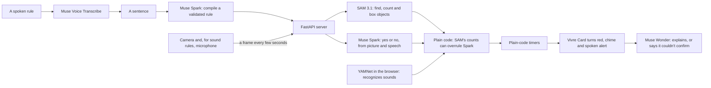

# Vivre

**Tell it what to look for, in a sentence, and it keeps watch.**

When I was six, my family's apartment burned down because a stove was left on overnight. My grandparents have fallen while home alone. Most accidents aren't surprises, they're unwatched.

**Try it:** https://web-production-749fb.up.railway.app (allow the camera, then pick or say a rule)

**Vivre is a prototype, not a safety device.** It checks every few seconds and can miss things or get things wrong. It complements smoke alarms and medical-alert gear and doesn't replace them.

## What Vivre can do

- Turn a plain sentence, typed or spoken, into a rule you can read
- Watch a camera and alert you when a rule comes true, with a chime, a spoken alert and a one-sentence explanation
- Time things, like "for 10 seconds", in plain code, with a card whose corner folds further as the time runs
- Hear speech, like someone calling for help, and recognize sounds, like clapping or a baby crying
- Keep a log of alerts with real times and short replay clips
- Send alerts to a second device through a private link
- Show which model did what, with timings and estimated cost

## How it works

## What it uses

| Model | Job |
|---|---|
| Muse Spark 1.2 | Compiles sentences into rules, and answers each rule's question from the picture and speech |
| SAM 3.1 | Finds, counts and draws boxes around objects. For camera rules, its counts can overrule Spark |
| Muse Wonder 1.0 | Double-checks camera alerts before they fire, and explains alerts in one sentence |
| Muse Voice Transcribe | Turns a spoken rule into text |
| YAMNet, by Google, not a Meta model | Recognizes everyday sounds in the browser, through MediaPipe |

Muse Spark, SAM, Wonder and Voice Transcribe run through the Meta Model API. The key stays on the server and never reaches the browser.

## Safety and privacy

**What Vivre can access**

- The camera, once you allow it, and only while the page is open
- The microphone, only for a spoken rule or a rule about sounds
- Nothing else on your device

**What leaves your device**

- Camera frames go to Meta's API on each check
- For speech and sound rules, a few seconds of sound go to Meta's API
- Spoken rules go to Meta's API to be transcribed

**What Vivre keeps**

- The server keeps the last few frames and the latest sound clip in memory during a session, and never writes them to disk. There's no database.
- Alert clips stay in your browser until you close the tab
- A second device gets cards and alerts, never video or sound

Vivre doesn't identify anyone. Only film people who agreed. Rules that compile to questions about who someone is aren't what it's for.

## Limits

- Each check takes a few seconds, so Vivre can miss things that are over in a moment
- The page has to stay open, and live sessions stop after 4 minutes to control cost. It can't watch overnight yet
- It has only been tried in a few simple scenes. Expect false alarms and misses
- The sound recognizer has been tried on clapping and a recording of a baby crying. Speech rules hear words best
- On iPhone, the spoken alert has been unreliable, though the card and chime still work
- At times, Meta's API has answered the hosted server with "model not found" while a laptop worked. The cause isn't known. Vivre retries, then says so, and the example sound rules still work. Running it locally avoids this
- Live use is capped per session, per visitor and overall

## Run it

1. `python3 -m venv .venv && source .venv/bin/activate`
2. `pip install -r requirements.txt`
3. Copy `.env.example` to `.env` and add your Meta Model API key. Never commit `.env`.
4. `uvicorn server:app --reload`, then open http://localhost:8000 in Chrome or Safari.

Tests use fake models, so they cost nothing: `python -m unittest discover tests` and `node --test tests/frontend.test.mjs`

Hosted, set `MODEL_API_KEY` and `TRUST_PROXY=1` in the host's settings. `.env.example` lists the spending caps.

## How it was built

Built for the Meta Global AI Developer Hackathon, on Nov 3 and 4, 2026. Built with Claude; the models are Meta's, apart from YAMNet.

Commit dates show exactly what changed and when. The original 6:00 PM PT submission didn't include the sound recognizer, the alert clips, repeat alerts or the redesign, which came after that time and before submissions fully closed.

`static/vendor/` holds Google's MediaPipe audio library (`@mediapipe/tasks-audio`, Apache-2.0) and the YAMNet model. See `static/vendor/README.txt`. The interface audit drew on [unslop](https://github.com/heydamir/unslop) by Damir Sokolovsky (CC BY 4.0).
