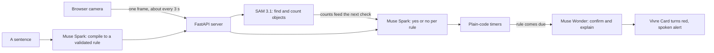

# Vivre

Describe what to watch for in a sentence. Vivre watches a camera and speaks up when it happens.

Built for the Meta Global AI Developer Hackathon. All of the code in this repository was written during the event (Nov 3 to 4, 2026). Built with Claude; the models are Meta's.

**Vivre is a prototype, not a safety device.** It checks every few seconds and can miss things or get things wrong. It complements smoke alarms and medical-alert gear and doesn't replace them.

## How it works

- **Muse Spark** turns each sentence into a rule, then answers its yes/no question on each check.
- **SAM 3.1** finds and counts the objects a rule names. It runs beside the checks, so it doesn't slow them down.
- **Plain Python timers** decide when "for 10 seconds" has passed, so timing isn't left to a model.
- **Muse Wonder** only runs when a rule comes due. It looks at the last few frames and explains the alert in one plain sentence, or rejects it.
- Still frames skip the model calls to save money.

## Privacy and limits

- Frames are sent to Meta's API for analysis. Vivre keeps the last few in memory during a session and never writes them to disk. Only film people who agreed.
- Each check takes a few seconds, so Vivre won't catch something that is over in a moment.
- It has only been tried on a few simple scenes. Expect false alarms and misses.
- Spoken alerts need the page open. It doesn't send phone notifications and isn't connected to any camera system.
- Live use is capped per session, per visitor and overall. When a cap is reached, the app switches to a recorded sample.

## Run it

1. `python3 -m venv .venv && source .venv/bin/activate`
2. `pip install -r requirements.txt`
3. Copy `.env.example` to `.env` and add your Meta Model API key. Never commit `.env`.
4. `uvicorn server:app --reload`, then open http://localhost:8000 in Chrome or Safari.

Tests use fake models, so they cost nothing: `python -m unittest discover tests`

Hosted, set `MODEL_API_KEY` and `TRUST_PROXY=1` in the host's settings. `.env.example` lists the spending caps.
