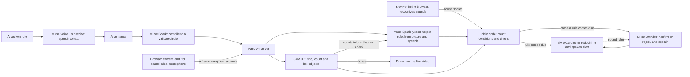

# Vivre

Most accidents aren't surprises, they're unwatched. Tell Vivre what to watch for in a plain sentence, and it keeps watch through a camera and microphone, then speaks up when it happens.

**Try it:** https://web-production-749fb.up.railway.app (Chrome or Safari, allow the camera, then pick or type a rule)

**Vivre is a prototype, not a safety device.** It checks every few seconds and can miss things or get them wrong. It complements smoke alarms and medical-alert gear and doesn't replace them.

Built for the Meta Global AI Developer Hackathon, Build for Your World. Built with Claude. Vivre uses Meta's models, plus one Google model named below.

## What can Vivre do?

- **Watch for what you describe.** Type or say a rule, like "Tell me if a cup is left on the table for 10 seconds", and read the rule it creates on its Vivre Card.
- **Watch and listen.** It checks the camera for what a rule names, and listens for speech like a call for help, or for sounds like clapping or a baby crying.
- **Time things.** Plain code tracks how long something has lasted, and the card's corner folds further as a timer runs.
- **Alert you.** A chime, a spoken alert, a red card and a one-sentence explanation. A new incident gets its own alert.
- **Keep a record.** Each alert is logged with its time and a short replay clip, kept only in your browser.
- **Reach another room.** A private link sends cards and alerts to a second device, without the video or sound.

## How it works

| Stage | Model | Job |
|---|---|---|
| Hear | Muse Voice Transcribe | Turns a spoken rule into text |
| Understand | Muse Spark 1.2 | Turns a sentence into a structured rule, which the server validates. The example buttons use saved rules instead |
| See | SAM 3.1 | Finds and counts objects for camera rules, and draws them. "Nobody at the desk" becomes "0 person", and if SAM sees a person, plain code overrules Spark |
| Judge | Muse Spark 1.2 | Answers each rule's question from the frame, and from recent sound for speech rules |
| Listen | YAMNet, by Google, not a Meta model | Recognizes everyday sounds in your browser, through MediaPipe |
| Confirm | Muse Wonder 1.0 | Before a camera alert, confirms or rejects it. For sound rules, the alert fires first and Wonder explains afterward, and says so if it disagrees |

Still frames skip the model calls, and the expensive model only runs when a rule comes due. The screen shows each model's job, timing and estimated cost.

## Safety and privacy

**What Vivre can access**
- Only the camera and microphone you allow, in that browser tab, while you're watching.
- The microphone only turns on for a spoken rule or a rule about sounds.
- It can't reach your files or other apps. The models are given no tools, and the server checks what they return before using it.

**Where your data goes**
- Camera frames are sent to Meta's API for analysis. For speech rules, a few seconds of sound are too.
- The sound recognizer runs in your browser. For sound rules, a short clip still goes to Meta's API so Wonder can explain the alert.
- A second-device link shares card states and alerts, never video or sound. Anyone with the link can see those while the session runs.

**What Vivre keeps**
- The server holds the last few frames and the latest sound clip in memory during a session, and writes no frames or sound to disk.
- Replay clips stay in your browser until you close the tab or start a new session, unless you download one.
- There are no accounts and no database.

Only film people who have agreed. All of the code is public here, so you can check this yourself.

## Limits

- Each check takes a few seconds, so Vivre can miss something that's over in a moment.
- It has only had informal tests in a few simple scenes. Expect false alarms and misses.
- Sound recognition has been tried with real clapping and a baby crying video. Other sounds are untested.
- A rule won't fire if SAM can't find something a camera rule requires.
- Motion rules compare two frames a few seconds apart.
- Alerts need the page open. Vivre doesn't send phone notifications and isn't connected to any camera system.
- **The hosted link may not work at times.** Meta's API has repeatedly answered the hosted server with "model not found" for long stretches, while the same calls from a laptop worked. The cause isn't known. Example sound rules still work then. Running Vivre locally avoids this.
- Live use is capped per session, per visitor and overall, and a session stops after 4 minutes. A restart can reset the overall count.

## What was built when

Vivre's core, and the version in the submitted demo video, were written during the hackathon (Nov 3 to 4, 2026).

**Added after the 6:00 PM PT deadline on Nov 4:** the in-browser sound recognizer, repeat alerts, real timestamps, replay clips, faster sound alerts, iPhone fixes and this redesign. Commit dates show exactly what changed and when.

## Run it

1. `python3 -m venv .venv && source .venv/bin/activate`
2. `pip install -r requirements.txt`
3. Copy `.env.example` to `.env` and add your Meta Model API key. Never commit `.env`.
4. `uvicorn server:app --reload`, then open http://localhost:8000 in Chrome or Safari.

Tests use fake models, so they cost nothing: `python -m unittest discover tests` and `node --test tests/frontend.test.mjs`

Hosted, set `MODEL_API_KEY` and `TRUST_PROXY=1` in the host's settings. `.env.example` lists the spending caps.

## APIs and third-party files

- **Meta Model API:** Muse Spark, Muse Wonder, SAM 3.1 and Muse Voice Transcribe.
- **`static/vendor/`:** Google's MediaPipe audio library (`@mediapipe/tasks-audio`, Apache-2.0) and the YAMNet model. See `static/vendor/README.txt`.
- **Design review:** the audit method came from [unslop](https://github.com/heydamir/unslop) by Damir Sokolovsky (CC BY 4.0).
