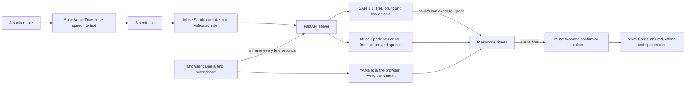

# Vivre

Most accidents aren't surprises, they're unwatched.

Vivre lets you say or type what to watch for, in one plain sentence. It keeps watch through your camera and microphone, and speaks up when it happens. There's nothing to install, and it runs in a browser.

**Try it:** https://web-production-749fb.up.railway.app (the hosted link can fail at times, see [Limits](#limits))

**Vivre is a prototype, not a safety device.** It checks every few seconds and can miss things or get things wrong. It complements smoke alarms and medical-alert gear and doesn't replace them.

Built for the Meta Global AI Developer Hackathon. Built with Claude; the models are Meta's, apart from the sound recognizer noted below.

## What can Vivre do?

- Turn any sentence, typed or spoken, into a rule you can read on its card
- Watch for things in view, like "Tell me if a cup is left on the table for 10 seconds"
- Listen for speech, like "Tell me if someone calls for help"
- Recognize everyday sounds, like clapping or a baby crying
- Time how long something lasts, with plain code, not a model
- Alert you with a chime, a spoken explanation and a red card
- Keep a log of alerts, each with its time and a short replay clip
- Send alerts to a second device through a private link, without sharing the video or sound
- Show which model did what, how long it took and what it cost

## How it works

| Model | Job |
|---|---|
| **Muse Voice Transcribe** | Turns a spoken rule into text you can check and edit |
| **Muse Spark 1.2** | Compiles each sentence into a structured rule, then answers its question on each check, from the picture and any speech |
| **SAM 3.1** | Finds the objects a camera rule names and draws them on the video. Its counts can decide: "nobody at the desk" compiles to "0 person", and if SAM sees a person, plain code overrules Spark's yes |
| **Muse Wonder 1.0** | Confirms camera alerts before they fire, and explains sound alerts just after |
| **YAMNet (Google, not a Meta model)** | Recognizes sounds like clapping in the browser, because Spark and Wonder often missed non-speech sounds in our tests |

Still frames skip the model calls to save money. Sound rules never use SAM, so someone out of view can still be heard.

## Safety and privacy

### What Vivre can access

- **Camera:** only after you turn it on, and only while the page is open.
- **Microphone:** only for a spoken rule or a rule about sounds. Other rules never turn it on.
- Nothing else on your device. Vivre has no accounts, and it doesn't identify anyone. Its prompts tell the models not to say who someone is or how they look.

### Where your data goes

- **To Meta's API:** one camera frame for each check, and the last few seconds of sound for speech rules. Vivre uses Meta's standard tier, not the cheaper contributor tier, whose content may be used for training.
- **On the server:** the last few frames and the latest sound clip stay in memory during a session. They're never written to disk or logged.
- **In your browser:** alert clips and the session review stay there until you close the tab or start again, unless you download them.
- **The sound recognizer** runs on your device, though sound rules also send clips to Meta's API as above.
- **A second device** gets the cards and alerts, never the video or sound. Anyone with the private link can see them while the session runs.
- **Fonts** load from Google Fonts, so your browser contacts Google when the page opens.

Only film people who agreed. Live use is capped per session, per visitor and overall, to limit spending.

## Limits

- It checks every few seconds, so it won't catch something that's over in a moment. Motion rules compare two frames a few seconds apart.
- It has only been tried informally on a few simple scenes. Expect false alarms and misses. A SAM miss can hold back a camera alert, because a rule won't fire if SAM can't find what it requires.
- Speech and sound recognition can fail in noisy rooms. Sound alerts fire on the recognizer or Spark alone, and Wonder's check comes afterward.
- Vivre can't hear calls while it's speaking an alert.
- Alerts need the page open. It doesn't send phone notifications, and it isn't connected to any camera system.
- On iPhone, the spoken alert has been unreliable while the microphone is on.
- **The hosted link may not work at times.** On Nov 4, Meta's API often answered the hosted server with "model not found", for long stretches, while the same calls from a laptop worked. The cause isn't known. The six example rules start without Meta's API, but only clapping and crying keep working during those periods. Running it locally avoids this.

## What was built when

The core app was written during the hackathon, on Nov 3 and 4, 2026, and the submitted demo video shows that version.

**Added after the submission deadline (6:00 PM PT, Nov 4), and not in the submitted video:** the in-browser sound recognizer, saved example rules, repeat alerts, real clock times, replay clips, faster sound alerts, fixes for Safari and iPhone, and the redesigned screen. Commit dates show exactly what changed and when.

## Run it

1. `python3 -m venv .venv && source .venv/bin/activate`
2. `pip install -r requirements.txt`
3. Copy `.env.example` to `.env` and add your Meta Model API key. Never commit `.env`.
4. `uvicorn server:app --reload`, then open http://localhost:8000 in Chrome or Safari.

Tests use fake models, so they cost nothing: `python -m unittest discover tests` and `node --test tests/frontend.test.mjs`

Hosted, set `MODEL_API_KEY` and `TRUST_PROXY=1` in the host's settings. `.env.example` lists the spending caps.

## Third-party files

`static/vendor/` holds Google's MediaPipe audio library (`@mediapipe/tasks-audio`, Apache-2.0) and the YAMNet model. See `static/vendor/README.txt`. The redesign used the audit method from [unslop](https://github.com/heydamir/unslop) by Damir Sokolovsky (CC BY 4.0).
