# Vivre

Describe what to watch for in a sentence. Vivre watches a camera and speaks up when it happens.

**Try it:** https://web-production-749fb.up.railway.app (allow the camera, then pick or type a rule)

Built for the Meta Global AI Developer Hackathon. All of the code in this repository was written during the event (Nov 3 to 4, 2026), except as noted below. Built with Claude; the models are Meta's, apart from the sound recognizer below.

**Added after the submission deadline (6:00 PM PT, Nov 4):** the in-browser sound recognizer and the changes that support it. The submitted demo video doesn't show them. Commit dates show exactly what changed and when.

**Vivre is a prototype, not a safety device.** It checks every few seconds and can miss things or get things wrong. It complements smoke alarms and medical-alert gear and doesn't replace them.

## How it works

```mermaid
flowchart LR
  V[A spoken rule] --> H[Muse Voice Transcribe: speech to text]
  H --> R[A sentence]
  R --> C[Muse Spark: compile to a validated rule]
  C --> S[FastAPI server]
  B[Browser camera and, for sound rules, microphone] -->|a frame every few seconds| S
  S --> M[SAM 3.1: find, count and box objects]
  S --> J[Muse Spark: yes or no per rule, from picture and sound]
  M -->|counts inform the next check| J
  M -->|boxes| O[Drawn on the live video]
  J --> G[Plain code: SAM's count conditions can overrule Spark]
  M --> G
  G --> T[Plain-code timers]
  T -->|rule comes due| W[Muse Wonder: confirm or reject, and explain]
  W --> A[Vivre Card turns red, chime and spoken alert]
```

- **Muse Voice Transcribe** turns a spoken rule into text you can check and edit. Typing works too.
- **Muse Spark** compiles each sentence into a structured rule, shown on its card: the question, the objects to look for, the counts that must hold, how long it must last, and whether it needs sound or motion. Then it answers the question on each check, from the picture and, for sound rules, the last few seconds of sound.
- **SAM 3.1** finds the objects a rule names and draws them on the video. Its counts aren't just a hint: "nobody at the desk" compiles to "0 person", and if SAM sees a person, plain code overrules Spark's yes. It runs beside the checks, so it doesn't slow them down.
- **Plain Python timers** decide when "for 10 seconds" has passed, so timing isn't left to a model.
- **Muse Wonder** only runs when a rule comes due. It looks at the last few frames, listens if the rule uses sound, and explains the alert in one plain sentence, or rejects it.
- **YAMNet, by Google, not a Meta model,** recognizes everyday sounds like clapping, crying and alarms. It runs in the browser through MediaPipe, once a second. Muse Spark picks which sounds a rule needs, plain code fires the alert, and Muse Wonder writes the explanation afterward.
- Still frames skip the model calls to save money.
- **Alerts reach another device.** While watching, "Get alerts on another device" makes a private link. That device gets the cards, the alert log, a chime and the spoken alert, but never the video or sound.

## Privacy and limits

- Frames are sent to Meta's API for analysis. Vivre keeps the last few in memory during a session and never writes them to disk. Only film people who agreed.
- The microphone only turns on for a spoken rule or a rule about sounds. The recognizer runs on your device, but those few seconds of sound also go to Meta's API and are treated the same way as frames.
- Each check takes a few seconds, so Vivre won't catch something that is over in a moment.
- It has only been tried on a few simple scenes. Expect false alarms and misses. A SAM miss can also hold back a real alert, because a rule won't fire if SAM can't find what it requires.
- Sound rules: speech goes through Muse Spark and Muse Wonder, which often missed other sounds in our tests. Sounds like clapping or a crying baby are decided by the YAMNet recognizer in the browser. These worked in one informal test each, with real clapping and a baby crying video. Expect misses and false alarms.
- Motion rules compare two frames a few seconds apart, so quick movements can be missed.
- Spoken alerts need the page open. It doesn't send phone notifications and isn't connected to any camera system.
- Live use is capped per session, per visitor and overall. When a cap is reached, or Meta's models can't be reached from the server, live watching stops and the app says why.
- **The hosted link may not work at times.** On Nov 4, Meta's API often answered calls from the hosted server with "model not found", for long stretches, while the same calls from a laptop worked. The cause isn't known. When this happens, Vivre retries for about a minute and then says so. Running it locally (see below) avoids this.

## Run it

1. `python3 -m venv .venv && source .venv/bin/activate`
2. `pip install -r requirements.txt`
3. Copy `.env.example` to `.env` and add your Meta Model API key. Never commit `.env`.
4. `uvicorn server:app --reload`, then open http://localhost:8000 in Chrome or Safari.

Tests use fake models, so they cost nothing: `python -m unittest discover tests` and `node --test tests/frontend.test.mjs`

Hosted, set `MODEL_API_KEY` and `TRUST_PROXY=1` in the host's settings. `.env.example` lists the spending caps.

## Third-party files

`static/vendor/` holds Google's MediaPipe audio library (`@mediapipe/tasks-audio`, Apache-2.0) and the YAMNet model. See `static/vendor/README.txt`.
